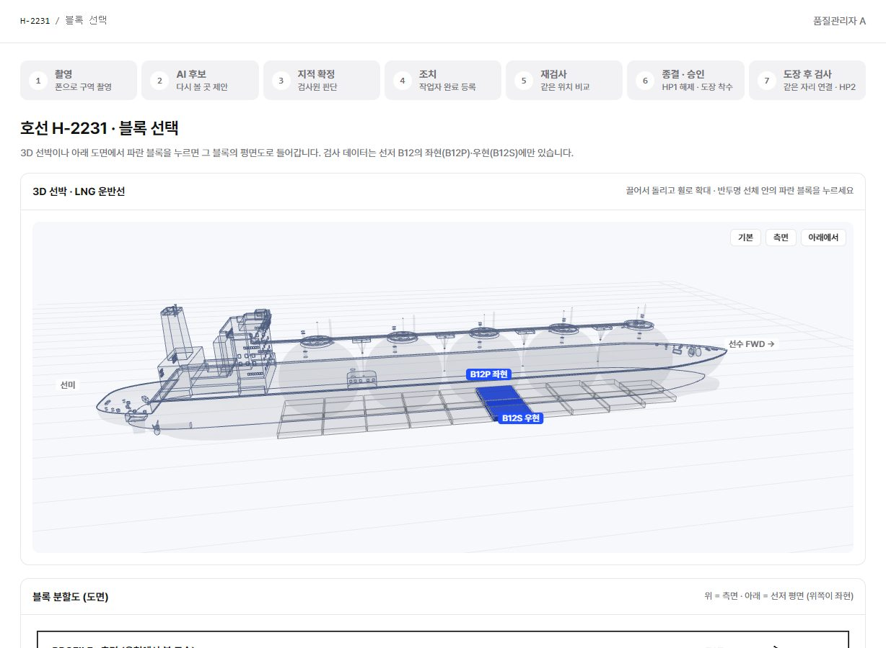
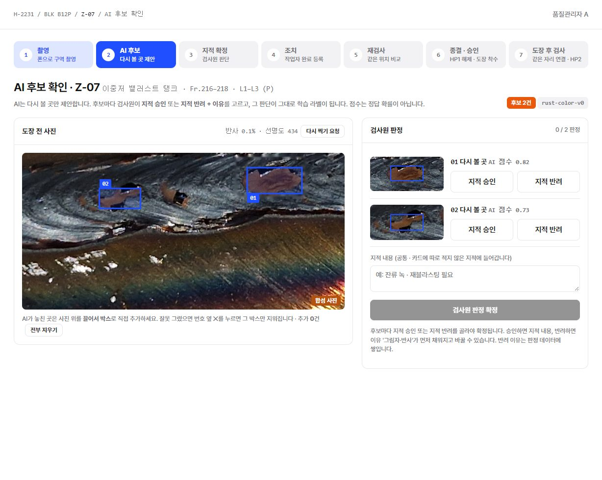
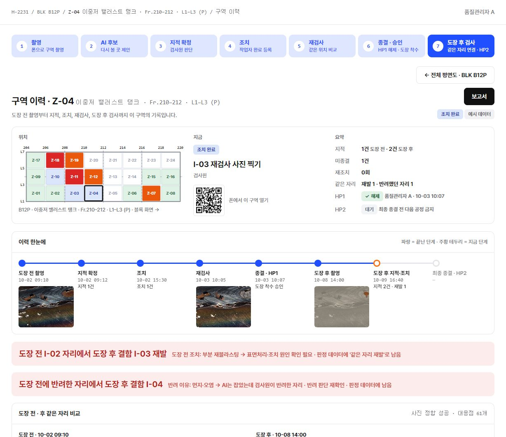
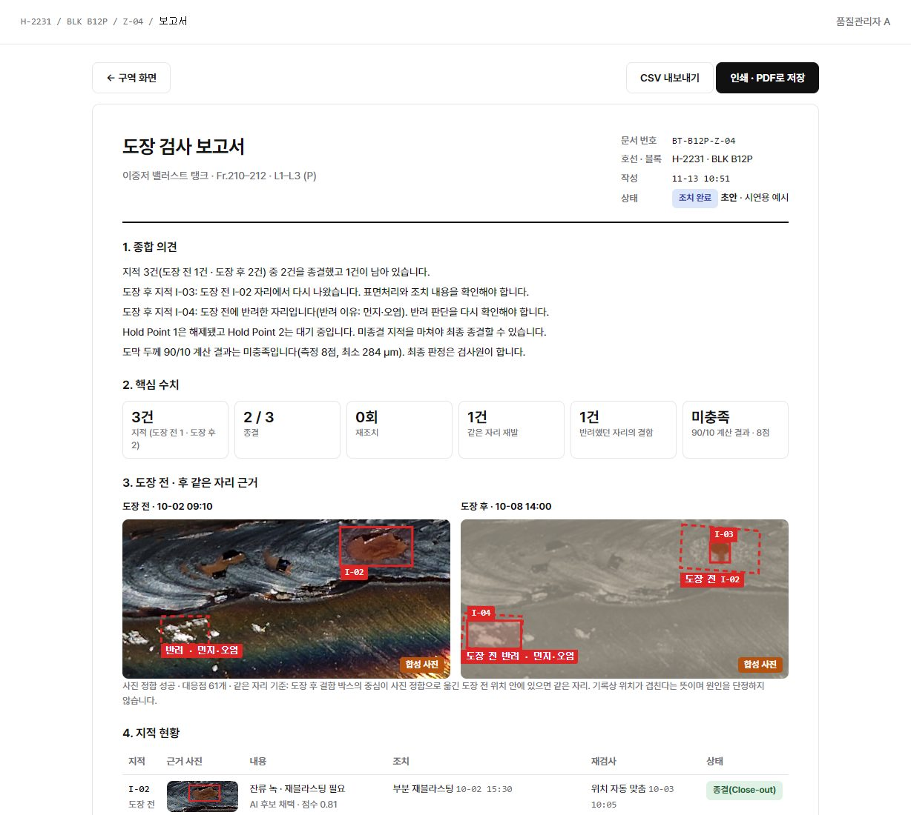
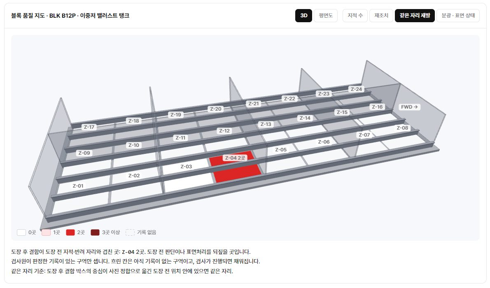
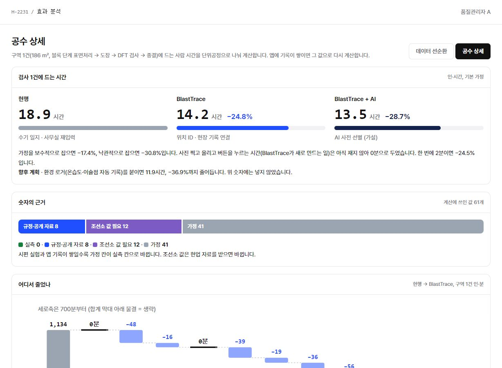

# BlastTrace

**블록 도장 검사에서 도장 전 판단과 도장 후 결과를 같은 자리로 잇는 검사 기록 모듈**(시연용 웹)

**2026 K-조선 해커톤 본선 · 품질 트랙 최우수상**



## 왜 만들었나

블록 도장 검사는 도장 전 표면처리 검사, 재검사, 도장 후 검사를 서로 다른 날에 다른 사람이 합니다. 검사하는 강판 표면에는 고정 좌표도 없습니다.
그래서 도장 후 결함이 나와도, 그 자리에서 도장 전에 무엇을 보고 어떻게 판단했는지가 이어지지 않습니다.

BlastTrace는 폰 사진과 **사진 정합**으로 같은 자리를 찾아 지적 → 조치 → 재검사 → 도장 후 검사를 한 구역의 기록으로 묶습니다.
그리고 도장 전 검사원의 판단(지적·반려)을 도장 후 결과로 채점해 학습 데이터로 남깁니다.
판정은 검사원이 하고, AI는 다시 볼 곳만 제안합니다.

## 주요 기능

| | |
|---|---|
|  | **AI 후보와 검사원 판정**<br>폰으로 찍은 사진에 AI가 다시 볼 곳을 표시합니다. 검사원은 후보마다 지적 승인 또는 반려(이유)를 고르고, AI가 놓친 곳은 사진 위에 직접 박스를 그립니다. 이 판단이 그대로 학습 라벨이 됩니다. |
|  | **재검사·도장 후 같은 자리 연결**<br>재검사 사진과 도장 후 사진을 도장 전 사진에 정합(SIFT + RANSAC)해 이전 지적 위치를 겹쳐 보여 줍니다. 도장 후 결함이 도장 전 지적 자리에 있으면 **같은 자리 재발**, 반려했던 후보 자리에 있으면 **반려했던 자리**로 자동 분류합니다. |
|  | **구역 이력과 보고서**<br>한 구역의 촬영·지적·조치·재검사·Hold Point 승인을 한 줄 이력으로 보고, 종합 의견·근거 사진·남은 조치·승인란이 있는 A4 보고서와 CSV로 내보냅니다. |
|  | **품질 분석**<br>블록 평면도와 3D 철판에 지적 수, 재조치, 같은 자리 재발, 분광 표면 상태를 칠해 봅니다. 도막 두께 게이지 값을 넣으면 PSPC 90/10을 계산합니다(최종 판정은 검사원). |
|  | **효과 분석**<br>구역 1건 검사 시간을 단위 공정으로 나눈 공수 모델(현행 18.9 → 14.2시간, 가정 포함)과, 여러 검사원이 26주 동안 쓴다고 가정한 데이터 선순환 시뮬레이션입니다. 실측이 아니라 계산값이며, 값마다 출처와 가정을 함께 보여 줍니다. |

그 밖에:
- **위치는 도면 이름으로**: 3D 선박 → 블록 → 단면에서 면 → 평면도에서 구역(프레임 × 론지)을 고릅니다. 블록이 뒤집혀 만들어지기도 해서 위·아래가 아니라 배 기준 부재 이름으로 부릅니다.
- **Hold Point와 승인 기록**: 도장 전 지적이 모두 종결되면 Hold Point 1(도장 착수 승인), 도장 후 검사가 끝나면 Hold Point 2가 해제되고 승인자와 시각이 남습니다. AI는 해제하지 않습니다.
- **판정 데이터 내보내기**: 이미지 + COCO(결함) + 반려 박스(따로 분리) + CSV를 zip으로 내보냅니다. 사진마다 출처(현장 / 시편 / 공개 / 합성)를 남겨 성능을 출처별로 나눠 셀 수 있습니다.
- **인터넷 없이 동작**: 노트북 한 대가 서버를 돌리고 폰은 같은 와이파이에서 QR로 붙습니다. 3D(Three.js)도 저장소 안에 들어 있습니다.

## 실행

Python 3.10 이상, 저장소 맨 위 폴더에서:

```bash
pip install -r requirements.txt
uvicorn server.app:app --host 0.0.0.0 --port 8000
```

- 노트북: http://localhost:8000
- 폰: 노트북 화면 왼쪽 아래 **폰 접속 주소 QR**을 찍습니다(같은 와이파이). 윈도우 방화벽 창이 뜨면 허용합니다.
- 처음 켜면 `data/`에 예시 구역(블록 2개 × 면 4개 × 24칸)과 예시 기록이 들어갑니다.
- 처음 상태로 되돌리기: 사이드바의 **시연 초기화**, 또는 서버를 끈 상태에서 `python -m server.reset`.
- 전체 흐름 테스트(서버 없이, 임시 DB): `python test_flow.py` → `OK`가 나오면 정상입니다.

### 선택 기능

| 기능 | 필요한 것 | 없으면 |
|---|---|---|
| AI 후보(YOLO11n-seg) | `pip install ultralytics` + 가중치 `cv/weights/best_rust_seg_aug.pt` (저장소에 없음) | 색 규칙(`rust-color-v0`)으로 후보 표시 |
| 분광 표면 상태 분류(RF) | 모델 `sensor/weights/spectral_rf.joblib` (저장소에 없음) | 품질 지도에 "모델 파일이 없어 분류하지 못했습니다" 표시 |
| 보고서 AI 요약 | 로컬 [Ollama](https://ollama.com) | 요약 없이 규칙으로 만든 보고서 |

환경변수: `BT_DATA`(DB 폴더), `BT_WEIGHTS`(YOLO 가중치 경로), `BT_ORIGIN`(새 사진 출처, 기본 `시편`), `BT_SPECTRAL=1`(폰 지적 카드의 분광 측정 켜기), `BT_SENSOR=sim|device`.

### 발표 화면이 다른 노트북일 때

서버는 우리 노트북에서 돌리고 [cloudflared](https://github.com/cloudflare/cloudflared/releases) 빠른 터널로 인터넷 주소를 엽니다(계정 없음).

```powershell
& "$HOME\tools\cloudflared.exe" tunnel --no-autoupdate --protocol http2 --url http://localhost:8000
```

로그에 나오는 `https://○○○.trycloudflare.com`을 발표 노트북에서 열면 왼쪽 아래 폰 QR도 그 주소로 바뀌고, 폰은 LTE로 붙습니다.
`--protocol http2`(TCP 443)는 기본값인 QUIC(UDP)보다 학교·행사장 망에서 덜 끊깁니다. 터널 창을 다시 켜면 주소가 바뀝니다.

## 시연 흐름

예시 구역 `Z-07`(이중저 밸러스트 탱크 · Fr.216–218 · L1–L3 (P))로 한 바퀴 돕니다. `test_flow.py`가 같은 순서를 검사합니다.

| 순서 | 어디서 | 할 일 |
|---|---|---|
| ① | 폰 | 블록 `B12P` → 면 ① 이중저 밸러스트 탱크 → 구역 `Z-07` → 사진(`web/static/samples/before.png`). 반사가 심하거나 어두우면 다시 찍게 함 |
| ② | 노트북 | "폰에서 사진 도착" 알림 → AI 후보 확인. 01은 지적 승인, 02는 반려(이유) |
| ③ | 폰 | 지적 카드(사진 + 빨간 박스)에서 작업자가 조치 완료 등록 |
| ④ | 폰 → 노트북 | 재검사 사진(`after.png`) → 노트북에 이전 지적 위치가 겹쳐 뜸 → 종결 → **Hold Point 1 해제** |
| ⑤ | 노트북 | 구역 화면: 한눈에 · 이력 한 줄 · 지적별 이력 · 보고서 |
| ⑥ | 폰 → 노트북 | 도장 후 사진(`painted.png`) → 도장 전 지적 위치가 점선으로 겹침 → 지적 확정 → **같은 자리 재발** 배너 → 조치 → 재검사(`painted_fixed.png`) → **최종 종결(Hold Point 2 해제)** |

`Z-04`는 도장 후 단계까지 들어 있는 예시(같은 자리 재발 + 반려했던 자리), `Z-03`은 조치 완료까지 넣어 둔 예시입니다.
화면의 상태 이름은 지적(Open) · 종결(Close-out) · 최종 종결(Release)이고, 코드 값은 `Punch Open` · `Close-out` · `Release 완료`입니다.

## 구조

| 폴더 | 내용 |
|---|---|
| `server/` | FastAPI 서버(`app.py`: DB, 화면·폰 라우트, 같은 자리 판정, 내보내기), 촬영 품질 확인, 공수 모델(`effect.py`), 초기화, 터널 도우미 |
| `web/` | Jinja2 화면(`templates/`), 스타일, 3D(`static/ship3d.js`, Three.js), 예시 사진, 3D 선박 모델 |
| `cv/` | `predict.py` AI 후보, `align.py` 사진 정합(SIFT + RANSAC) |
| `llm/` | 보고서 요약(로컬 Ollama, 사실 줄 고정 + 문장 검증) |
| `sensor/` | 분광 측정값 해석(AS7343), 표면 분류 모델 불러오기 |
| `shared/` | 모듈끼리 주고받는 데이터 예시(JSON·CSV) |

서버는 아래 함수만 부릅니다. 이름과 돌려주는 모양만 지키면 안쪽을 바꿔도 서버를 고칠 필요가 없습니다(예시는 `shared/`).

| 함수 | 지금 | 반환 예시 |
|---|---|---|
| `cv.predict.predict(image_path, real)` | 실제 사진 = YOLO11n-seg(조각을 묶어 후보 5개까지), 합성 예시 사진·가중치 없는 PC = 색 규칙 | `shared/predict.json` |
| `cv.align.align(before_path, after_path)` | SIFT + RANSAC, 찌그러지거나 뒤집힌 변환은 실패로 처리 | `shared/align.json` |
| `llm.report.peek_report(record)` | 보고서 AI 요약(Ollama가 있으면 뒤에서 만들어 둠) | 입력 `shared/record.json`, 반환 `shared/report.json` |
| `sensor.spectral.classify(rows)` | 강판 / 도장 / 녹 3클래스 RF | 입력 측정 CSV 행, 반환 `[(클래스, 확신도)]` |

좌표는 0\~1 비율로 저장합니다. `predict`와 `align`은 원본 픽셀을 돌려주고 서버가 바꿉니다.
3D 프론트용 구역 JSON은 `/api/zones/{구역}/case`(예시 `shared/case.json`)입니다.

## 한계

- **시연용 예시입니다.** 선형은 KRISO 공개 표준 선형(KLNG2)을 바탕으로 했고, 호선 번호·블록 분할·도면 치수와 시작 상태의 기록은 지어낸 값입니다. 실제 조선소 데이터는 쓰지 않았습니다.
- `web/static/samples/`의 예시 사진은 공개 데이터셋 사진을 가공·합성한 것입니다(아래 출처). 앱은 이 사진을 알아보고 "합성"으로 표시합니다.
- 사진 정합은 평판 시편과 합성 사진에서만 확인했습니다. 곡면·용접부와, 무늬가 가려진 실제 도장면에서는 검증하지 않았습니다.
- AI 후보 모델과 분광 모델은 팀이 찍은 소수의 평판 시편으로 학습한 시험 모델이라, 일반 성능을 뜻하지 않습니다. AI 후보는 판정이 아닙니다.
- 분광(가시광)으로는 도막 두께와 도막 밑 녹을 볼 수 없습니다. 도막 두께는 게이지 값을 넣습니다.
- 효과 분석의 숫자는 공개 자료와 가정으로 만든 모델 계산값입니다. 앱에 시편·현장 기록이 쌓이면 일부 값을 기록에서 잰 값으로 바꿉니다.

## 사용한 오픈소스와 자료

| 이름 | 쓰는 곳 | 라이선스 |
|---|---|---|
| [FastAPI](https://fastapi.tiangolo.com), Uvicorn, Jinja2 | 서버·화면 | MIT / BSD |
| [OpenCV](https://opencv.org), NumPy, Pillow | 사진 정합·처리 | Apache-2.0 / BSD / MIT-CMU |
| [segno](https://github.com/heuer/segno) | 폰 접속 QR | BSD |
| [scikit-learn](https://scikit-learn.org) | 분광 분류 모델 불러오기 | BSD |
| [Three.js](https://threejs.org) r160 | 3D 화면(`web/static/vendor/three`, 라이선스 파일 포함) | MIT |
| [Ultralytics](https://github.com/ultralytics/ultralytics) | 선택 기능 AI 후보(저장소에 포함하지 않음) | AGPL-3.0 |
| [cloudflared](https://github.com/cloudflare/cloudflared) | 선택 기능 터널(저장소에 포함하지 않음) | Apache-2.0 |

- **3D 선박 모델**(`web/static/models/lng_ship.glb`): KRISO(한국해양과학기술원 부설 선박해양플랜트연구소)가 공개한 LNG 운반선 표준 선형 **KLNG2**를 3D로 띄운 것입니다.
- **예시 사진**(`web/static/samples/`의 `before.png`, `after.png`, `painted.png`, `painted_fixed.png`): [SteelBlastQC Dataset](https://doi.org/10.34894/EKZNN0)(Ruzavina, Theis, Lemeer, de Groen, Ebeling, Hulak, Ali, Tang, Mockel, 2025, DataverseNL, [CC BY 4.0](https://creativecommons.org/licenses/by/4.0/))의 사진을 바탕으로, 팀이 재작업 흔적·도장 색·녹 번짐을 그려 넣고 원근을 바꿔 만든 가공·합성 사진입니다. 관련 논문: [arXiv:2504.20510](https://arxiv.org/abs/2504.20510).

## 팀

| 이름 | 역할 |
|---|---|
| 박상우 | PM · 팀장 |
| 인선우 | LLM · 데이터 · 분광 (`llm/`, `sensor/`) |
| 박동희 | CV · 데이터 (`cv/`, 학습 모델) |
| 노재혁 | 개발 (`server/`, `web/`) |

## 라이선스

[MIT](LICENSE). 저장소에 들어 있는 Three.js는 자체 MIT 라이선스를 따릅니다. 선택 기능인 Ultralytics(AGPL-3.0)는 저장소에 포함하지 않으며, 설치해 쓸 때는 그 라이선스를 따릅니다.
